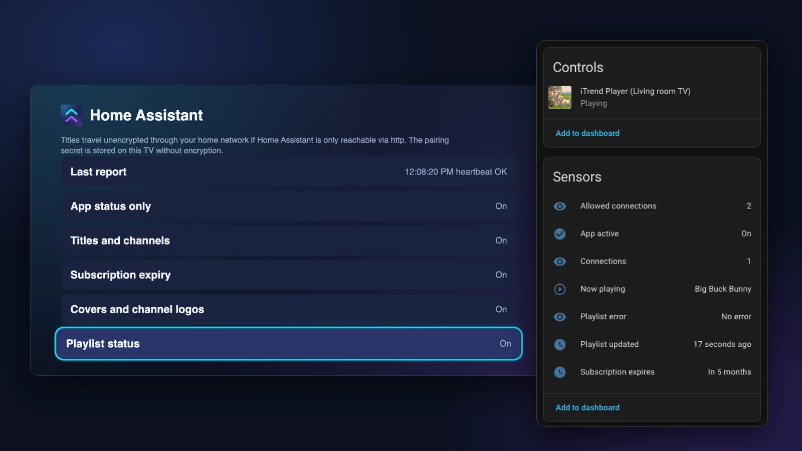
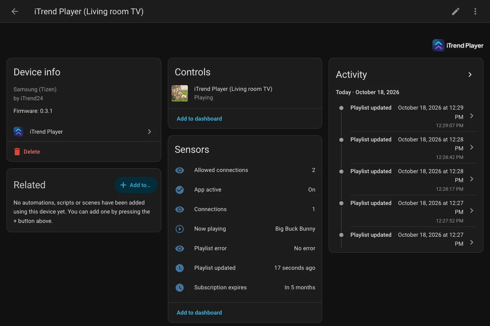
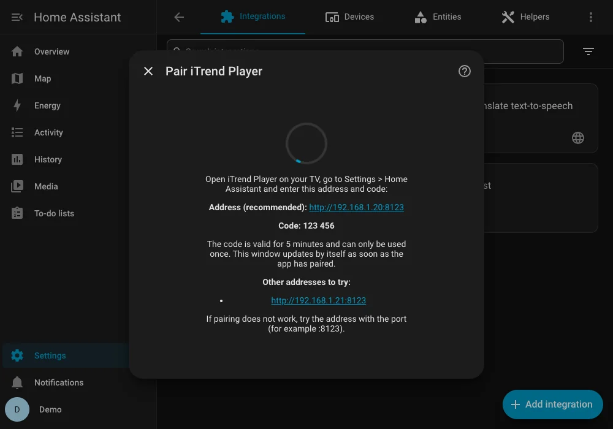
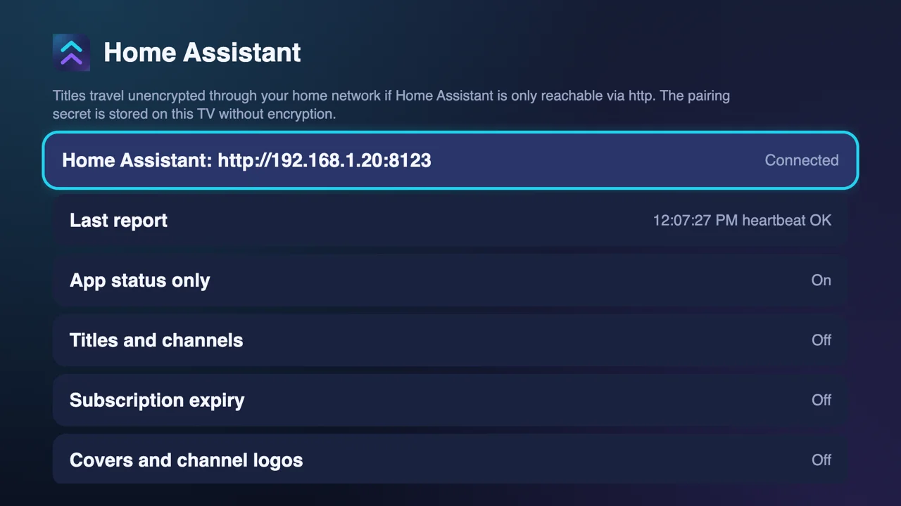
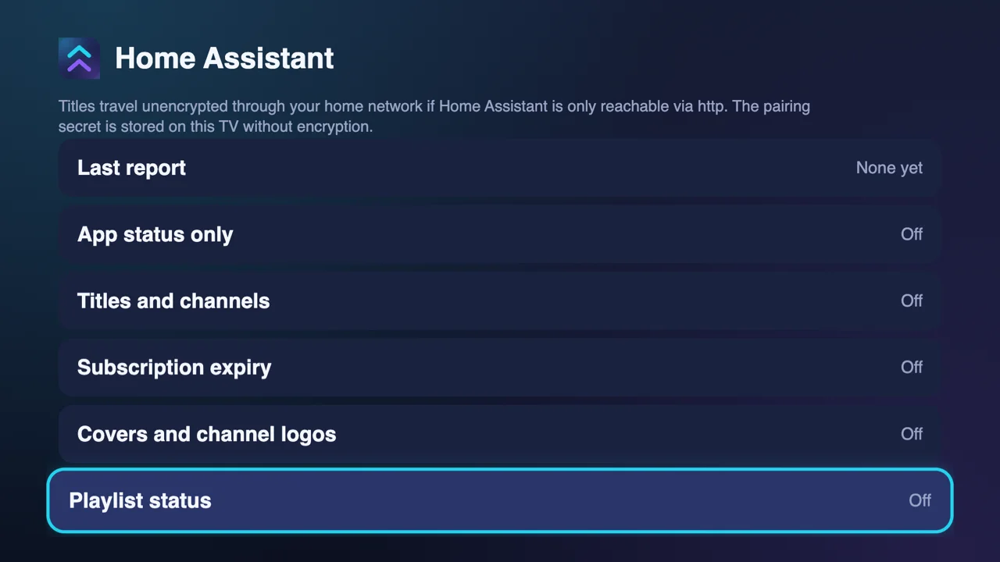
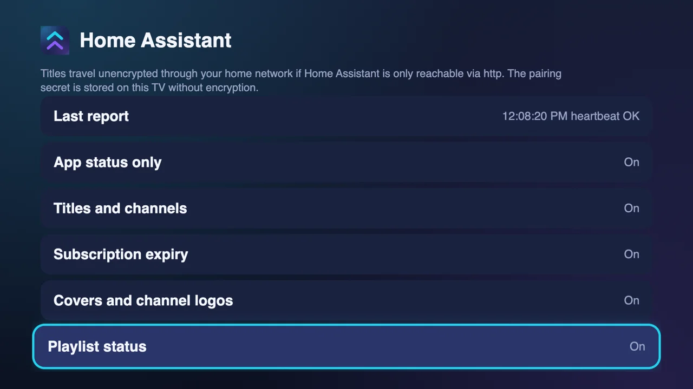
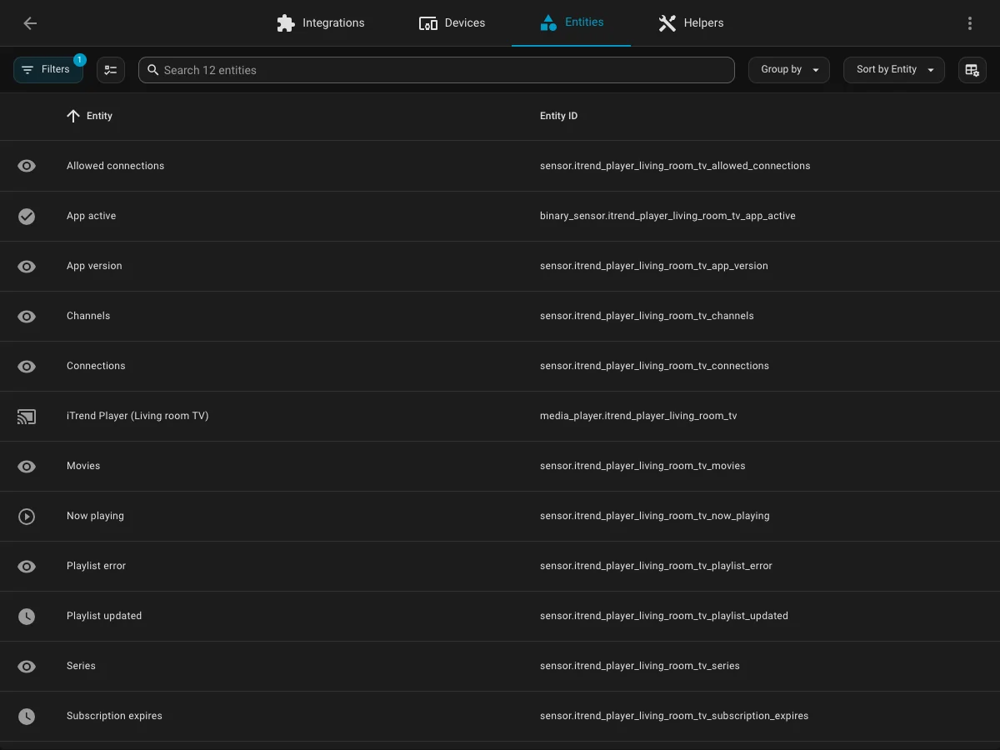
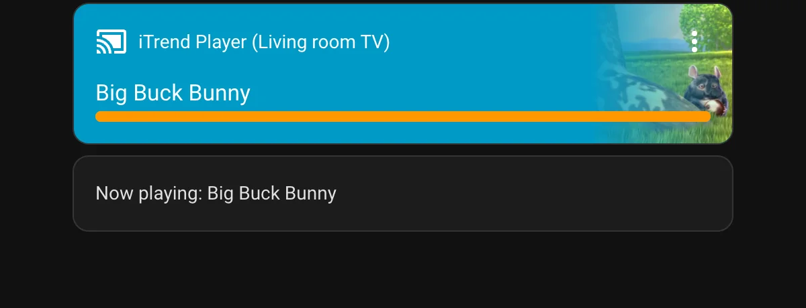

# iTrend Player for Home Assistant / für Home Assistant

[English](#english) | [Deutsch](#deutsch)

  



**iTrend Player: IPTV player for Fire TV & Android TV / IPTV-Player für Fire TV & Android TV** – [player.itrend24.de](https://player.itrend24.de)

> Status: **Version 0.3.2**: secure pairing, receiving state (title, series, cover/channel logo, playlist status, subscription expiry, connections), sensors and events. Control (play/pause/…) comes later (stage 3) after a separate security review.
> Status: **Version 0.3.2**: sichere Kopplung, Zustand empfangen (Titel, Serie, Cover/Senderlogo, Playlist-Status, Abo-Ablauf, Verbindungen), Sensoren und Ereignisse. Steuerung (Play/Pause/…) folgt später (Stufe 3) und braucht eine eigene Sicherheitsprüfung.

---
## English

This integration shows in Home Assistant what iTrend Player is doing on your TV, for example to dim the lights when a film starts. The app provides no content; the integration only receives the app's state, locally on your network. There is no cloud and nothing is sent to iTrend24 or third parties.



### Features

- Media player with state, title, series, season, episode, duration and position, plus cover or channel logo (when allowed)
- "Now playing" sensor (title as text)
- App version, "App active", subscription expiry, allowed and active connections (if your provider reports them)
- Playlist status: last refresh, number of channels, movies, series, kind of error
- Events on the Home Assistant bus (`playback_started`, `playback_stopped`, `channel_changed`, `trailer_opened`, `playlist_refreshed`, `playlist_failed`) for automations
- Pairing by code (SRP-6a), every message signed
- Off by default: the app sends nothing until you allow each kind of data separately; content from categories locked with the PIN is never sent

### Requirements

- Home Assistant 2026.2 or newer (the icon appears from 2026.3 on; older versions show the default icon)
- The [iTrend Player app](https://player.itrend24.de) on your TV, in a version with Home Assistant support
- TV and Home Assistant can reach each other over the network

### Installation via HACS (custom repository)

1. Open HACS, menu (three dots) > **Custom repositories**.
2. Add `https://github.com/Cangos655/itrend-player-homeassistant`, category **Integration**.
3. Search **iTrend Player** in HACS, download it, restart Home Assistant.

Without HACS: copy the folder `custom_components/itrend_player` into `config/custom_components/` of your Home Assistant installation and restart.

### Pairing step by step

1. In Home Assistant: **Settings > Devices & services > Add integration > iTrend Player.**
2. Home Assistant shows a **six-digit code** and the **address** of your Home Assistant instance. The code is valid for 5 minutes, works once, and allows at most 3 wrong attempts.

   
3. In the app on the TV: **Settings > Home Assistant**, enter address and code and confirm the transmission notes.

   
4. As soon as the app has paired, Home Assistant asks about network access (see "Entering the address correctly"; the option is preset to off if the request comes from the local network) and then creates the device (name taken from the app, e.g. "iTrend Player (Living room TV)").
5. In the app choose what to share (see "What is shared"). Until then nothing is sent.

   

   
6. Several TVs: repeat; each TV gets its own device and its own secret.

**Renew pairing:** if the app ended the pairing or it is no longer valid, Home Assistant offers **Reconfigure / Renew pairing** on the entry. Entities and history are kept.

**Delete:** deleting the device or entry removes the webhook and the key. The app will then show "renew pairing" and can be disconnected.

### Entering the address correctly

The dialog shows the recommended address and further candidates.

- **Include the port.** If Home Assistant does not run on port 80/443 (usually 8123), the port belongs in the address even if your `external_url` omits it, for example `http://192.168.1.20:8123` or `https://example.duckdns.org:8123`. If pairing does not work, try the address with the port.
- **No `.local` names.** The apps do not resolve them; use the IP address or a domain name.
- **`https` needs a domain name** that matches the certificate (an IP address will not work then).
- **Domain, proxy, Nabu Casa or hairpin NAT:** if the TV reaches Home Assistant this way, the sender appears as a public address and Home Assistant by default drops the messages (the app shows "unconfirmed (`empty_body`)" and "App active" stays off). After pairing, the setup dialog asks for the option **Also allow requests from outside the home network** (preset to off if the request comes from the local network; preset to on if pairing came from outside or another entry uses the option). Change it later via entry > gear (Configure). Security hardly changes because every message is signed and sequence numbers and rate limits still apply.

### What is shared

Only what you allow in the app is sent. Each switch is separate and off by default; some build on others.

| Switch in the app | What is sent | Needs | Entities and events in Home Assistant |
|---|---|---|---|
| App status only | status and heartbeat, events without content | pairing | Media player (state only), "App active", app version, events without title |
| Titles and channels | title, channel, series/season/episode, type, duration, position | App status only | Media player attributes, "Now playing" sensor, `media` in events |
| Subscription expiry | expiry date, active and allowed connections | App status only | Sensors "Subscription expires", "Connections", "Allowed connections" |
| Covers and channel logos | address of the cover or logo image | Titles and channels | Entity picture of the media player |
| Playlist status | last refresh, number of channels, movies, series, kind of error (no addresses or names) | App status only | Sensors "Playlist updated", "Channels", "Movies", "Series", "Playlist error"; events `playlist_refreshed`, `playlist_failed` |

Credentials, playlist and provider addresses are never sent.

### Entities (per TV)

| Entity | Content |
|---|---|
| Media player | playing, paused, buffering, idle, off, unavailable; title, channel, type, series/season/episode, duration, position, cover. No control features in stage 1. |
| Now playing sensor | title as text: movie = title, episode = "Series, Season S, Episode E", live = channel; otherwise "–". **Note:** Home Assistant stores the state in its history; to exclude it set `recorder: exclude: entity_globs: [sensor.*_now_playing]` (check the entity ID). |
| App version sensor | diagnostic |
| Subscription expiry sensor | timestamp (start of the reported day), only if the app shares it |
| Connections sensor | active connections, attribute `connections_max` |
| Allowed connections sensor | `connections_max` as reported by the provider (also available without active connections) |
| Playlist sensors | "Playlist updated", "Channels", "Movies", "Series" (diagnostic), "Playlist error" |
| App active binary sensor | on while the app is sending |



Events on the HA bus: `itrend_player_event` with `type` = `playback_started`, `playback_stopped` (`reason`), `channel_changed`, `trailer_opened`, `playlist_refreshed`, `playlist_failed` (`error`), plus `device_id`, `entry_id` and, if shared, `media`.

After about **90 seconds** without a sign of life (three missed heartbeats) entities become "unavailable". This cannot be distinguished from "TV off". If the app quits cleanly, the media player switches to "off" immediately.

**Covers:** If the app shares covers, the media player uses the reported image address as the entity picture. Your browser or the Home Assistant app loads the image directly from that address (the image host will see those requests); Home Assistant and the integration never fetch anything server-side. The address is checked strictly (no private/local addresses, no credentials, no stream patterns). Image addresses and titles are not kept in the recorder history.

### Dashboard example

A media player card shows cover and title; a Markdown card shows the text of the "Now playing" sensor (check the entity IDs of your TV; for the device "iTrend Player (Living room TV)" they start with `itrend_player_living_room_tv`):

```yaml
type: vertical-stack
cards:
  - type: media-control
    entity: media_player.itrend_player_living_room_tv
  - type: markdown
    content: >
      Now playing: {{ states('sensor.itrend_player_living_room_tv_now_playing') }}
```



The "Controls" card on the device page (e.g. "iTrend Player (Living room TV)") shows only the state, such as "Playing"; title and cover are in the dashboard example above (series, season and episode are also in the attributes).

### Privacy and security

- Only what you allow in the app is sent (see "What is shared"). The default is nothing. Credentials, playlist and provider addresses are never sent.
- Messages are sent as a **signed webhook** (HMAC-SHA-256; the key is never transmitted). Over `http` in your home network the content is **not encrypted**: titles can be read on the same network. Use `https` where possible.
- Keys are kept in Home Assistant's config entry storage. The integration itself stores no titles or channels; it excludes the media player's title attributes from the recorder history. **Exception:** the state of the "Now playing" sensor is the title, and the Home Assistant recorder stores it in the history. If you do not want that, exclude the sensor with `recorder: exclude` (example in the entity table) or disable it. Events (`itrend_player_event`) may contain titles; automations, logbook and logs are your responsibility.
- Do not publish Home Assistant logs: Home Assistant itself writes webhook addresses of unregistered webhooks to the log.
- If a pairing code gets locked without you having entered it wrongly, someone on your network is trying to interfere. Create a new code.

### Troubleshooting

| Symptom | Cause | Remedy |
|---|---|---|
| Pairing fails, "not reachable" | wrong address, `.local` name, different network | address with port (`http://192.168.1.20:8123`), no `.local`, TV and Home Assistant on the same network |
| `https` with an IP address fails | certificate name does not match | use a domain name or `http` |
| Code "wrong" or locked | valid 5 minutes, 3 attempts | create a new code; a lock without your own wrong entry means someone on the network is interfering |
| App shows "unconfirmed (`empty_body`)", "App active" stays off | Home Assistant drops messages from outside the home network (domain, proxy, Nabu Casa, hairpin NAT) | enable Configure > **Also allow requests from outside the home network** |
| Entities "unavailable" | no sign of life for about 90 s | TV off or app closed, not distinguishable |
| No cover | provider delivers `http` images only (mixed content), or "Covers and channel logos" is off | switch the option on; otherwise it is the provider's image server or the browser |
| Titles appear in the history | the "Now playing" sensor state is the title | exclude the sensor via `recorder: exclude` |
| "Pairing needs renewing" | key invalid or ended in the app | reconfigure / renew pairing on the entry |
| "Please update the app or the integration" | protocol versions differ | update the app and the integration |

### Protocol

The protocol (pairing with SRP-6a, signatures, test vectors) is described in [`docs/protocol/PROTOCOL.md`](docs/protocol/PROTOCOL.md); `vectors.json` and `reference.py` are next to it. Implementation decisions: [`docs/DECISIONS.md`](docs/DECISIONS.md).

### Development

```bash
python3.13 -m venv .venv && . .venv/bin/activate
pip install -r requirements_test.txt
pytest
```

License: MIT.

---

## Deutsch

Diese Integration zeigt in Home Assistant, was iTrend Player auf deinem Fernseher gerade tut, zum Beispiel um das Licht zu dimmen, wenn ein Film beginnt. Die App liefert keine Inhalte; die Integration empfängt nur den Zustand der App, lokal in deinem Netz. Es gibt keine Cloud und keine Weitergabe an iTrend24 oder Dritte.


### Funktionen

- Media-Player mit Zustand, Titel, Serie, Staffel, Folge, Dauer und Position, dazu Cover oder Senderlogo (wenn freigegeben)
- Sensor „Läuft gerade“ (Titel als Text)
- App-Version, „App aktiv“, Abo-Ablauf, erlaubte und aktive Verbindungen (falls dein Anbieter sie meldet)
- Playlist-Status: letzte Aktualisierung, Anzahl Sender, Filme, Serien, Fehlerart
- Ereignisse auf dem Home-Assistant-Bus (`playback_started`, `playback_stopped`, `channel_changed`, `trailer_opened`, `playlist_refreshed`, `playlist_failed`) für Automationen
- Kopplung per Code (SRP-6a), jede Meldung signiert
- Standardmäßig aus: Die App sendet nichts, bis du jede Datenart einzeln freigibst; Inhalte aus mit PIN gesperrten Kategorien werden nie gesendet

### Voraussetzungen

- Home Assistant 2026.2 oder neuer (das Symbol erscheint ab 2026.3, ältere Versionen zeigen das Standard-Icon)
- Die App [iTrend Player](https://player.itrend24.de) auf dem Fernseher, in einer Version mit Home-Assistant-Unterstützung
- Fernseher und Home Assistant erreichen sich über das Netzwerk

### Installation über HACS (benutzerdefiniertes Repository)

1. HACS öffnen, Menü (drei Punkte) > **Benutzerdefinierte Repositories**.
2. Adresse `https://github.com/Cangos655/itrend-player-homeassistant` eintragen, Kategorie **Integration**, hinzufügen.
3. **iTrend Player** in HACS suchen, herunterladen, Home Assistant neu starten.

Ohne HACS: den Ordner `custom_components/itrend_player` in das Verzeichnis `config/custom_components/` deiner Home-Assistant-Installation kopieren und neu starten.

### Kopplung Schritt für Schritt

1. In Home Assistant: **Einstellungen > Geräte & Dienste > Integration hinzufügen > iTrend Player.**
2. Home Assistant zeigt einen **sechsstelligen Code** und die **Adresse** deiner Home-Assistant-Instanz an. Der Code gilt 5 Minuten, nur einmal und erlaubt höchstens 3 Fehlversuche.

   
3. In der App am Fernseher: **Einstellungen > Home Assistant**, Adresse und Code eingeben, die Hinweise zur Übertragung bestätigen.

   
4. Sobald die App gekoppelt hat, fragt Home Assistant nach dem Netzwerkzugriff (siehe „Adresse richtig angeben“; die Option ist aus vorbelegt, wenn die Anfrage aus dem lokalen Netz kommt) und legt dann das Gerät an (Name aus der App, z. B. „iTrend Player (Wohnzimmer-TV)“).
5. In der App festlegen, was gesendet wird (siehe „Was freigegeben wird“). Bis dahin wird nichts gesendet.

   

   
6. Mehrere Fernseher: Schritte wiederholen; jeder Fernseher hat ein eigenes Gerät und ein eigenes Geheimnis.

**Kopplung erneuern:** Hat die App die Kopplung beendet oder ist sie ungültig, bietet Home Assistant am Eintrag **Neu konfigurieren / Kopplung erneuern** an. Entitäten und Verlauf bleiben erhalten.

**Löschen:** Gerät oder Eintrag in Home Assistant löschen entfernt Webhook und Schlüssel. Die App meldet danach „Kopplung erneuern“ und kann getrennt werden.

### Adresse richtig angeben

Der Dialog zeigt die empfohlene Adresse und weitere Kandidaten.

- **Mit Port.** Läuft Home Assistant nicht auf Port 80/443 (meist 8123), gehört der Port in die Adresse, auch wenn deine `external_url` ihn nicht nennt, z. B. `http://192.168.1.20:8123` oder `https://beispiel.duckdns.org:8123`. Funktioniert die Kopplung nicht, probiere die Adresse mit Port.
- **Keine `.local`-Namen.** Die Apps lösen sie nicht auf; nutze die IP-Adresse oder einen Domainnamen.
- **`https` braucht einen Domainnamen**, der zum Zertifikat passt (eine IP-Adresse funktioniert dann nicht).
- **Domain, Proxy, Nabu Casa oder Hairpin-NAT:** Erreicht der Fernseher Home Assistant auf diesem Weg, erscheint der Absender als öffentliche Adresse, und Home Assistant verwirft die Meldungen standardmäßig (die App zeigt „nicht bestätigt (`empty_body`)“, „App aktiv“ bleibt aus). Der Einrichtungsdialog fragt nach der Kopplung nach der Option **Auch Anfragen von außerhalb des Heimnetzes erlauben** (aus vorbelegt, wenn die Anfrage aus dem lokalen Netz kommt; an vorbelegt, wenn die Kopplung von außen kam oder ein anderer Eintrag die Option nutzt). Nachträglich ändern: Eintrag > Zahnrad (Konfigurieren). Die Sicherheit ändert sich kaum, da jede Meldung signiert ist und Sequenznummern und Rate-Limits weiter gelten.

### Was freigegeben wird

Gesendet wird nur, was du in der App freigibst. Jeder Schalter ist einzeln und standardmäßig aus; manche bauen aufeinander auf.

| Schalter in der App | Was gesendet wird | Setzt voraus | Entitäten und Ereignisse in Home Assistant |
|---|---|---|---|
| Nur App-Status | Status und Herzschlag, Ereignisse ohne Inhalt | Kopplung | Media-Player (nur Zustand), „App aktiv“, App-Version, Ereignisse ohne Titel |
| Titel und Sender | Titel, Sender, Serie/Staffel/Folge, Typ, Dauer, Position | Nur App-Status | Attribute des Media-Players, Sensor „Läuft gerade“, `media` in Ereignissen |
| Abo-Ablauf | Ablaufdatum, aktive und erlaubte Verbindungen | Nur App-Status | Sensoren „Abo-Ablauf“, „Verbindungen“, „Erlaubte Verbindungen“ |
| Cover und Senderlogos | Adresse des Cover- bzw. Logo-Bildes | Titel und Sender | Entitätsbild des Media-Players |
| Playlist-Status | letzte Aktualisierung, Anzahl Sender, Filme, Serien, Fehlerart (keine Adressen oder Namen) | Nur App-Status | Sensoren „Playlist aktualisiert“, „Sender“, „Filme“, „Serien“, „Playlist-Fehler“; Ereignisse `playlist_refreshed`, `playlist_failed` |

Zugangsdaten, Playlist- und Anbieteradressen werden nie gesendet.

### Entitäten (je Fernseher)

| Entität | Inhalt |
|---|---|
| Media-Player | spielt, Pause, Puffern, Leerlauf, aus, nicht verfügbar; Titel, Sender, Typ, Serie/Staffel/Folge, Dauer, Position, Cover. Keine Steuerfunktionen in Stufe 1. |
| Sensor Läuft gerade | Titel als Text: Film = Titel, Folge = „Serie, Staffel S, Folge E“, Live = Sender; sonst „–“. **Hinweis:** Home Assistant speichert den Zustand im Verlauf; zum Ausschließen `recorder: exclude: entity_globs: [sensor.*_now_playing]` (Entitäts-ID prüfen) in der Konfiguration setzen. |
| Sensor App-Version | Diagnose |
| Sensor Abo-Ablauf | Zeitstempel (Beginn des gemeldeten Tages), nur wenn die App ihn freigibt |
| Sensor Verbindungen | aktive Verbindungen, Attribut `connections_max` |
| Sensor Erlaubte Verbindungen | `connections_max` laut Anbieter (kommt auch ohne aktive Verbindungen) |
| Playlist-Sensoren | „Playlist aktualisiert“, „Sender“, „Filme“, „Serien“ (Diagnose), „Playlist-Fehler“ |
| Binär-Sensor App aktiv | an, solange die App sendet |


Ereignisse auf dem HA-Bus: `itrend_player_event` mit `type` = `playback_started`, `playback_stopped` (`reason`), `channel_changed`, `trailer_opened`, `playlist_refreshed`, `playlist_failed` (`error`), dazu `device_id`, `entry_id` und, falls freigegeben, `media`.

Nach etwa **90 Sekunden** ohne Lebenszeichen (drei verpasste Herzschläge) werden die Entitäten „nicht verfügbar“. Das ist von „Fernseher aus“ nicht zu unterscheiden. Beendet die App ordentlich, wechselt der Media-Player sofort auf „aus“.

**Cover:** Gibt die App Cover/Senderlogo frei, setzt der Media-Player die gemeldete Bild-Adresse als Entitätsbild. Das Bild lädt dein Browser bzw. die Home-Assistant-App direkt von dieser Adresse (Bilderserver des Anbieters sehen dann deine Zugriffe); Home Assistant und die Integration laden nichts serverseitig. Die Adresse wird streng geprüft (keine privaten/lokalen Adressen, keine Zugangsdaten, keine Stream-Muster). Bild-Adressen und Titel stehen nicht im Recorder-Verlauf.

### Dashboard-Beispiel

Eine Media-Player-Karte zeigt Cover und Titel; eine Markdown-Karte zeigt den Text des Sensors „Läuft gerade“ (Entitäts-IDs deines Fernsehers prüfen; beim Gerät „iTrend Player (Wohnzimmer-TV)“ beginnen sie mit `itrend_player_wohnzimmer_tv`):

```yaml
type: vertical-stack
cards:
  - type: media-control
    entity: media_player.itrend_player_wohnzimmer_tv
  - type: markdown
    content: >
      Läuft gerade: {{ states('sensor.itrend_player_wohnzimmer_tv_now_playing') }}
```


Die Karte „Steuerung“ auf der Geräteseite (z. B. „iTrend Player (Wohnzimmer-TV)“) zeigt bei „Wiedergabe“ nur den Zustand; Titel und Cover stehen im Dashboard-Beispiel oben (Serie, Staffel und Folge zusätzlich in den Attributen).

### Datenschutz und Sicherheit

- Gesendet wird nur, was du in der App freigibst (siehe „Was freigegeben wird“). Standard ist: nichts. Zugangsdaten, Playlist- und Anbieteradressen werden nie gesendet.
- Die Übertragung erfolgt per **signiertem Webhook** (HMAC-SHA-256, Schlüssel wird nie übertragen). Bei `http` im Heimnetz ist der Inhalt **nicht verschlüsselt**: Titel sind im selben Netz mitlesbar. Wenn möglich `https` verwenden.
- Schlüssel liegen im Speicher der Konfigurationseinträge von Home Assistant. Die Integration selbst speichert keine Titel und Sender; sie nimmt Titelattribute des Media-Players vom Recorder-Verlauf aus. **Ausnahme:** Der Zustand des Sensors „Läuft gerade“ ist der Titel, und den speichert der Recorder von Home Assistant im Verlauf. Wer das nicht möchte, schließt den Sensor per `recorder: exclude` aus (Beispiel in der Entitäten-Tabelle) oder deaktiviert ihn. Ereignisse (`itrend_player_event`) können Titel enthalten; Automationen, Logbuch und Protokolle sind deine Sache.
- Veröffentliche keine Home-Assistant-Logs: Home Assistant selbst schreibt Webhook-Adressen unregistrierter Webhooks in das Protokoll.
- Wird ein Kopplungscode gesperrt, ohne dass du ihn falsch eingegeben hast, versucht jemand im Netz zu stören. Erzeuge einen neuen Code.

### Fehlersuche

| Symptom | Ursache | Abhilfe |
|---|---|---|
| Kopplung schlägt fehl, „nicht erreichbar“ | falsche Adresse, `.local`-Name, anderes Netz | Adresse mit Port (`http://192.168.1.20:8123`), kein `.local`, Fernseher und Home Assistant im selben Netz |
| `https` mit IP-Adresse scheitert | Zertifikatsname passt nicht | Domainnamen oder `http` verwenden |
| Code „falsch“ oder gesperrt | gilt 5 Minuten, 3 Versuche | neuen Code erzeugen; eine Sperre ohne eigene Fehleingabe heißt: Jemand im Netz stört |
| App zeigt „nicht bestätigt (`empty_body`)“, „App aktiv“ bleibt aus | Home Assistant verwirft Meldungen von außerhalb des Heimnetzes (Domain, Proxy, Nabu Casa, Hairpin-NAT) | Konfigurieren > **Auch Anfragen von außerhalb des Heimnetzes erlauben** einschalten |
| Entitäten „nicht verfügbar“ | seit ca. 90 s kein Lebenszeichen | Fernseher aus oder App beendet, nicht unterscheidbar |
| Kein Cover | Anbieter liefert nur `http`-Bilder (Mixed Content), oder „Cover und Senderlogos“ ist aus | Option einschalten; sonst liegt es am Bild-Server des Anbieters oder am Browser |
| Titel erscheinen im Verlauf | Der Zustand des Sensors „Läuft gerade“ ist der Titel | Sensor per `recorder: exclude` ausschließen |
| „Kopplung erneuern“ | Schlüssel ungültig oder in der App beendet | am Eintrag neu konfigurieren / Kopplung erneuern |
| „Bitte App oder Integration aktualisieren“ | Protokollversionen passen nicht | App und Integration aktualisieren |

### Protokoll

Das Protokoll (Kopplung per SRP-6a, Signatur, Testvektoren) ist in [`docs/protocol/PROTOCOL.md`](docs/protocol/PROTOCOL.md) beschrieben; `vectors.json` und `reference.py` liegen daneben. Entscheidungen der Umsetzung: [`docs/DECISIONS.md`](docs/DECISIONS.md).

### Entwicklung

```bash
python3.13 -m venv .venv && . .venv/bin/activate
pip install -r requirements_test.txt
pytest
```

Lizenz: MIT.

---
